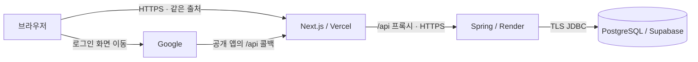

# PassMate 외부 공개 베타 설계안

작성: 2026-10-29 · 상태: **로그인·무료 서비스 구성 확정 / DB 기반 구현 / 인증·외부 배포 미완료**

## 1. 목표와 결정 상태

사용자가 확정한 방향은 외부 사용자 공개, 일반적인 개인 사이드 프로젝트, 무료 서비스 우선이다. 로그인은 아이디·비밀번호 회원가입/로그인과 Google 로그인 두 가지로 확정했다. 이메일 가입 인증, 비밀번호 재설정, 복구 코드와 메일 발송 서비스는 초기 범위에서 제외한다. 인원·트래픽은 아직 미정이다.

로그인 제공 범위는 [제품 범위](../../ARCHITECTURE.md), [데이터](DATA_MODEL.md), [API](API_CONTRACT.md), [사용자 흐름](USER_FLOW.md), [화면](SCREEN_SPEC.md)에 외부 공개 목표로 반영했다. 현재 구현은 여전히 로컬 프로필 선택 방식이다. 무료 서비스 구성은 Vercel Hobby + Render Free + Supabase Free로 확정했다. 도메인을 구매하지 않고 기본 HTTPS 주소를 사용한다. Supabase는 PostgreSQL 저장소로만 사용하며 인증은 Spring에서 처리한다. 세션 기간·운영 제한 수치 등은 여전히 제안이다.

설계 가정은 비상업적 소규모 베타, 소수 동시 사용자, 한 운영자다. 인원이나 상시 가용성을 보장하지 않는다. 첫 베타는 접근 대상을 제한하고, 사용량과 복구 능력을 확인한 뒤 확대한다. 학습 구조 `Material → FlashCard → ReviewHistory`와 현재 복습 간격은 유지한다.

## 2. 현재 코드에서 확인한 공개 차단 지점

정적 조사이며 침투 테스트나 실제 데이터 유출 재현 결과는 아니다.

| 영역 | 확인한 코드 | 외부 공개 전 변경 |
| --- | --- | --- |
| 사용자 식별 | frontend의 `passmate.selectedUser`, 요청의 `userId`; Security 의존성 없음 | 서버 인증 주체로 결정. 브라우저 프로필 선택 제거 |
| 사용자 API | `UserController`, `UserService.getAllUsers/getUser/updateUser/deleteUser` | 전체 프로필·이메일 목록과 임의 ID 조회·수정·삭제를 공개하지 않음 |
| 폴더·대시보드·삭제·복습 제출 | 전달된 userId로 소유 관계 확인 | 비교 기준을 인증된 사용자 ID로 교체 |
| 섹션·세트·카드 조회/생성/수정 | `CategoryService`, `MaterialService`, `FlashCardService`의 부모 ID 조회·저장 | **모든 메서드**에서 부모까지 사용자 소유 검증. 화면 숨김으로 대체하지 않음 |
| 일부 복습 조회 | `ReviewService.getReview/getFlashCardReviews/getUserReviews/getUserTodayReviews` | 이력·카드·사용자 범위를 함께 확인; 불필요한 구형 조회 경로 폐쇄 |
| 탈퇴 | `UserService.deleteUser`는 사용자 행만 삭제 | 학습 데이터·인증 연결·세션을 포함하는 탈퇴 흐름으로 교체 |
| 캐시 | `next.config.js`의 전체 경로 `public, max-age=3600` 설정 | 로그인 사용자 화면/API의 공유 캐시 금지. 실제 계정 간 캐시 동작도 검증 |
| DB | H2 파일, `ddl-auto: update`, H2 콘솔 활성화 | 운영 PostgreSQL·버전 마이그레이션·콘솔 비활성화 |
| 배포·검증 | 소스 CI는 있지만 운영 구성·인증 테스트 없음 | 배포/복구 절차와 인증된 A/B 계정 격리 테스트 추가 |

근거 위치는 `backend/src/main/java/com/passmate/domain/`의 controller/service, `backend/pom.xml`, `backend/src/main/resources/application.yml`, `frontend/src/lib/apiClient.ts`, `frontend/next.config.js`다. 순차 숫자 ID를 UUID로 바꾸는 것만으로 소유권 문제가 해결되지는 않는다. 요청마다 권한을 확인하는 원칙은 [OWASP 인가 안내](https://cheatsheetseries.owasp.org/cheatsheets/Authorization_Cheat_Sheet.html)를 따른다.

## 3. 확정: 아이디·비밀번호 가입/로그인 + Google 로그인

### 초기 범위

| 제공 | 후속으로 미룸 |
| --- | --- |
| 아이디·닉네임·비밀번호로 가입, 아이디·비밀번호 로그인 | 이메일 소유 확인·가입 인증 메일 |
| Google로 가입/로그인하고 같은 학습 기능 사용 | 비밀번호 찾기·재설정·복구 코드·본인 확인 질문 |
| 로그아웃, 서버 인증 주체로 사용자 데이터 격리 | 계정 연결/해제와 로그인 방식 전환 UI |

메일 주소는 일반 가입 필수 입력이 아니다. 아이디는 로그인 식별자이고 닉네임은 표시 이름이다. 비밀번호 확인은 화면 입력 검증용이며 서버에는 별도 필드로 저장하지 않는다. 비밀번호 정책·길이·중복 아이디 처리의 상세 수치는 구현 전에 API 원본에 정리한다.

비밀번호는 평문·복호화 가능한 값이 아닌 전용 비밀번호 해시로 저장한다. 해시 방식과 작업량은 Spring Security의 지원 조합·무료 서버 메모리를 기준으로 검증한다. 일반 가입과 로그인에도 CSRF·요청 빈도 제한·안전한 오류 응답을 적용한다. 기능을 단순화해도 비밀번호 저장과 사용자 격리 검증은 생략하지 않는다. [비밀번호 저장 원칙](https://cheatsheetseries.owasp.org/cheatsheets/Password_Storage_Cheat_Sheet.html)

### 일반 가입·로그인

1. `/signup`에서 아이디·닉네임·비밀번호·비밀번호 확인을 입력한다. 가입 버튼 가까이에 **“현재 비밀번호 찾기·재설정을 지원하지 않습니다. 비밀번호를 잊으면 이 계정에 다시 로그인할 수 없습니다.”**를 안내한다.
2. 서버는 아이디 중복과 입력값을 검증하고 User 및 LocalCredential을 하나의 트랜잭션으로 생성한다. 이메일 발송이나 이메일 인증 대기를 추가하지 않는다.
3. 가입 성공 후 `/login`으로 안내한다. 로그인에는 아이디·비밀번호만 사용한다.
4. 실패는 아이디 존재 여부와 비밀번호 오류를 구분하지 않는 공통 안내로 처리하고 로그인 시도를 제한한다.
5. 성공하면 세션 ID를 교체하고 학습 화면으로 이동한다. 계정 복구나 재설정 API·운영자 임의 비밀번호 변경 우회는 만들지 않는다.

### Google 가입·로그인

1. `/login`에 일반 로그인 폼과 Google 로그인 버튼을 함께 표시한다.
2. Spring의 `/api/oauth2/authorization/google`로 이동하고 Google 인증 후 공개 앱 주소의 `/api/login/oauth2/code/google`로 돌아온다. scope는 필요한 `openid`, `email`로 제한하고 표시 이름·사진을 필수 수집하지 않는다.
3. Spring Security가 Authorization Code/OIDC 응답의 서명·발급자·대상·만료·state/nonce를 검증한다. 지원 조합에서 PKCE도 사용하며 직접 JWT 검증기를 작성하지 않는다.
4. 검증된 `(issuer, subject)`로 계정을 찾는다. 첫 방문이면 온보딩에서 닉네임과 서비스 안내를 확인하고 User·AuthIdentity를 생성한다. Google 가입자에게 별도 아이디·비밀번호 생성을 강제하지 않는다.
5. Google 계정은 Google로 로그인하고, 인증 후에는 일반 로그인과 동일한 내부 User·세션·학습 API를 사용한다. Google 토큰이나 소유자 userId를 브라우저 저장소에 보관하지 않는다.

Google 이메일과 일반 가입 아이디/연락처가 같아 보여도 계정을 자동 합치지 않는다. 초기에는 두 경로로 각각 가입하면 별도 계정이며 데이터도 분리된다. 연결 기능을 추가할 때는 기존 계정의 재인증과 Google 인증을 모두 확인하는 별도 계약으로 다룬다. 이미 로그인한 상태에서 Google 로그인 버튼을 누르는 것만으로 계정을 연결하지 않는다. [Google OIDC](https://developers.google.com/identity/openid-connect/openid-connect), [Spring OAuth2 Login](https://docs.spring.io/spring-security/reference/servlet/oauth2/login/core.html)

### 재설정 미제공의 경계

일반 계정의 비밀번호를 잊으면 기존 자료에 재접근할 수 없으며, 새 계정을 만들거나 Google로 새로 가입해도 자료가 옮겨지지 않는다. 운영자가 닉네임·아이디·이메일 주장만으로 계정이나 자료를 넘겨주지 않는다. Google 계정 복구는 제공자의 절차를 사용한다. 초기 비밀번호 찾기 메뉴·작동하지 않는 링크·재설정 메일 설정을 만들지 않는다.

## 4. 브라우저 인증과 API 경계

### 서버 세션 추천

Spring Security와 Spring Session JDBC를 사용하고 세션을 PostgreSQL에 보관한다. 서버 휴면·재시작마다 로그인 상태가 사라지지 않게 하며, 초기에는 Redis나 자체 access/refresh JWT 체계를 추가하지 않는다. 두 로그인 방식 모두 같은 인증 주체를 사용하며 비밀번호와 Google 토큰을 애플리케이션 세션 식별자로 사용하지 않는다. JDBC 세션도 DB 사용량을 소비하므로 정리 작업·접속 풀을 무료 한도에 맞춰 측정한다. [Spring Session JDBC](https://docs.spring.io/spring-session/reference/configuration/jdbc.html)

- 운영 세션 쿠키: `__Host-PM_SESSION`, `Secure`, `HttpOnly`, `SameSite=Lax`, `Path=/`, Domain 없음. localhost 개발 설정은 운영과 분리한다.
- 세션 만료 초안: 유휴 1시간·절대 24시간, 로그인 유지 기능 없음. 절대 만료는 별도 검사한다. 최종 기간은 사용자 경험 결정 대상이다.
- 인증 필터에서 내부 User의 존재·활성 상태를 확인한다. 세션에 남은 옛 프로필만으로 탈퇴·정지 후 접근하지 못하게 한다.
- 쿠키 기반 인증이므로 CSRF를 유지한다. `/api/auth/csrf`에서 토큰을 받아 변경 요청의 헤더에 전달하고 로그인·로그아웃 후 재발급한다. 세션 쿠키의 HttpOnly를 해제하지 않는다.
- Google 콜백은 프레임워크의 state/nonce 검증을 사용한다. 전체 `/api/**`를 CSRF 예외로 지정하지 않는다.
- 정상 만료 API는 401 JSON, 소유하지 않은 대상은 404, CSRF 오류는 403, 제한 초과는 429를 사용한다. CSRF가 먼저 거부한 비인증 변경 요청은 403이 될 수 있으며 순서를 테스트한다. 보안 필터의 오류도 `{code,message}`로 작성한다.
- 자동 로그인 화면 리다이렉트는 페이지 진입에 적용한다. API 오류를 HTML 로그인 페이지로 반환하지 않는다.

이 설계는 세션과 CSRF 구현 원칙을 따른 추천이며 현재 코드에 이미 적용된 상태가 아니다. [세션 관리](https://cheatsheetseries.owasp.org/cheatsheets/Session_Management_Cheat_Sheet.html), [Spring CSRF](https://docs.spring.io/spring-security/reference/servlet/exploits/csrf.html)

### API 전환안

| 현재 런타임 API | 공개 베타 제안 |
| --- | --- |
| `GET/POST /api/users`, `GET/PATCH/DELETE /api/users/{userId}` | 운영에서 폐쇄. `GET/PATCH /api/users/me`, 재인증을 요구하는 `DELETE /api/users/me` 제공 |
| `/api/decks` 및 하위 리소스의 `?userId=` | URL 리소스 구조 유지, 소유자는 인증 주체로 결정. 구형 userId 쿼리는 400으로 거부해 계약 혼동 방지 |
| `/api/decks/{deckId}/categories/**` | 모든 조회·생성·수정·삭제에서 인증 사용자 → 폴더 → 섹션 관계 확인 |
| `/api/categories/{categoryId}/materials/**` | 세트 생성/카드 일괄 생성도 섹션 소유 검증. 존재하지 않는 부모에 저장하지 않음 |
| `/api/materials/{materialId}/cards/**` | 모든 작업에서 세트의 사용자 소유 검증 및 경로의 카드-세트 일치 확인 |
| `/api/reviews/users/{userId}/today` | `/api/reviews/today?materialId=...`; 선택적 세트 필터·기한·정렬 유지 |
| 사용자 ID가 포함된 기록 API | `/api/reviews/history`, `/api/reviews/history/today`; 구형 사용자 경로는 운영에서 폐쇄 |
| `GET /api/reviews/{reviewId}`, `GET /api/reviews/cards/{cardId}` | 필요 경로만 유지하며 인증 사용자·카드 소유·이력 소유를 함께 확인, 목록 상한 적용 |
| `POST /api/reviews/cards/{cardId}?userId=...` | 경로 유지, userId 제거, 인증 사용자와 소유 카드로 저장 |
| `GET /api/dashboard?userId=...` | userId 제거, 인증 사용자 집계 |
| 인증 진입 없음 | `POST /api/auth/signup`, `POST /api/auth/login`, Google 진입/콜백, `GET /api/auth/csrf`, `POST /api/auth/logout` 추가. 재설정 API는 제외 |

공개 허용 경로만 명시하고 나머지는 기본 인증 요구로 설정한다. 테스트·개발용 프로필 우회는 운영 코드에서 활성화하지 않는다. 서비스에도 authenticatedUserId를 전달하고 소유 조건을 저장소 조회에 포함한다. 프론트 체크만 추가하거나 컨트롤러 일부만 보호하는 상태로 공개하지 않는다.

로그아웃은 CSRF가 있는 POST로 세션을 무효화하고 쿠키와 화면의 사용자 데이터를 비운다. 뒤로 가기·새로고침·복수 탭에서도 다른 계정의 데이터를 다시 표시하지 않도록 재조회한다. 브라우저는 보호 API를 같은 출처 `/api`로 호출한다.

현재 복습 조회의 `date`, 제출의 `reviewedAt`도 클라이언트가 지정할 수 있다. 운영에서는 일반 복습의 일정·기한 기준을 서버 시각으로 결정하고 테스트 시간 주입을 분리하는 안을 추천한다. UTC 저장·사용자의 하루 경계는 별도 상세 데이터 계약으로 확정한다. 이를 기존 고정 간격 알고리즘의 변경과 혼동하지 않는다.

## 5. 데이터와 기존 프로필 처리

### 제안 스키마와 제약

- `User`: 학습 데이터 소유자 id·nickname·상태·생성/갱신 시각. 현재 email의 필수/유일 제약을 바꿔 일반 가입에 이메일을 요구하지 않는다. 실제 컬럼 전환 SQL은 후속 마이그레이션 설계 대상이다.
- `LocalCredential`: userId FK/UNIQUE, 정규화된 loginId UNIQUE, passwordHash. 일반 가입자에게만 존재하며 Google 전용 가입자는 이 행을 만들지 않는다. 로그인 아이디와 표시용 nickname을 구분한다.
- `AuthIdentity`: id, userId FK, issuer, subject, createdAt. `(issuer, subject)` UNIQUE. 첫 버전은 사용자당 Google 연결 하나만 허용하며 임의 재연결 API를 만들지 않는다.
- 세션: Spring Session JDBC 공식 스키마를 버전 마이그레이션에 포함한다. 세션에 사업 데이터·불필요한 제공자 토큰을 넣지 않고, 외부 API용 offline access는 요청하지 않는다.
- FK: Deck→User, Category→Deck, Material→Category, FlashCard→Material, ReviewHistory→User/FlashCard. 처음에는 삭제를 애플리케이션의 기존 트랜잭션으로 제어하고 DB 제약은 고아 데이터 생성을 막는다. ORM 관계 전체 개편은 필요하지 않다.
- 생성과 삭제가 경합하면 잘못된 하위 행을 남기는 대신 실패·롤백한다. 충돌 응답과 재조회 흐름을 검사한다. 복습 이력과 카드 소유자의 일치는 FK만으로 충분하지 않으므로 서비스에서도 확인한다.
- 사용자 관계·복습 기한·기록 정렬·AuthIdentity 조회에 필요한 인덱스를 실행 계획으로 확인한다. 요청 크기·카드 일괄 수·목록 상한을 서버에서도 검증하고 전체 테이블을 무제한 조회하지 않는다. 제한 수치는 실제 샘플과 부하 측정 후 확정한다.

### 로컬 데이터 이관

추천은 **공개 DB를 빈 상태로 시작**하는 것이다. 기존 H2 데이터는 로컬에 보존하고 운영에 테스트 계정이나 검증되지 않은 이메일을 자동 복사하지 않는다. 기존 자료 이관이 필요하면 원본 소유자가 본인 계정으로 명시적으로 가져오는 별도 절차를 설계한다. 이메일 일치로 소유자를 추정하지 않는다.

### 탈퇴·기록 보존

현재 카드/세트/폴더의 영구 삭제 정책은 유지한다. 탈퇴는 재인증 후 본인 데이터·이력·인증 연결을 삭제하는 별도 유스케이스로 구현하며 기존 `deleteUser`를 그대로 노출하지 않는다. User가 사라지거나 비활성화된 뒤에는 남은 세션으로 요청할 수 없어야 하고, 관련 모든 세션을 폐기한다. 세션 정리 실패가 접근 권한 복구로 이어지지 않도록 검사한다.

백업에 남은 삭제 자료의 만료와 복원 시 재삭제 기준도 운영 절차에 포함한다. 백업 보존기간과 접근 제한·삭제 요청 처리 기준은 공개 전에 정하며 '탈퇴 즉시 모든 백업에서도 소멸'이라고 안내하지 않는다.

## 6. 무료 우선 배포안

### 확정한 서비스 구성

| 역할 | 선택한 서비스 | 확인한 무료 조건과 선택 이유 |
| --- | --- | --- |
| Next.js | Vercel Hobby | 개인·비상업 용도에 한정된 무료 요금제. 기존 Next.js를 유지하고 기본 HTTPS 주소로 시작. 광고·결제 등 상업화 시 약관·요금제를 재검토 |
| Spring API | Render Free Web Service + Docker | 기존 Java 코드를 유지할 후보. 무료 서버는 비활성 시 잠들고 다시 켜지는 시간이 있어 즉시 응답을 약속할 수 없음 |
| PostgreSQL | Supabase Free | 조사 시점 DB 500MB·월 외부 전송 5GB·활성 프로젝트 최대 2개. 저활동 7일 후 일시 정지 가능. 앱 데이터와 세션 사용량을 함께 측정 |

이 조합은 무료 한도 안에서의 **실험적 공개 베타 구성**다. Render는 공식 문서에서 무료 인스턴스를 production 용도로 권장하지 않는다. 프리 티어가 무기한 동일 조건이거나 비용·가용성을 보장한다고 설명하지 않는다. [Vercel Hobby](https://vercel.com/docs/plans/hobby), [Render Free](https://render.com/docs/free), [Supabase 요금제](https://supabase.com/pricing)

Render 무료 PostgreSQL은 30일 만료 조건이 있어 지속 사용 DB 후보에서 제외한다. Supabase 무료 프로젝트의 저활동 시 일시 정지는 수동 복원 절차까지 확인한다. Supabase Auth·Storage·Realtime은 이번 범위에 도입하지 않는다. [Render 조건](https://render.com/docs/free), [Supabase 휴면 조건](https://supabase.com/docs/guides/platform/free-project-pausing)

### 요청 경로

- 기본 앱 주소 하나에서 `/api/**`를 Spring으로 전달하고 Next는 화면과 프록시만 맡는다. 인가·사용자 매핑을 Next와 Spring에 이중 구현하지 않는다.
- Render 주소는 인터넷에서 직접 접근 가능하다. 숨겨진 사설망이라고 가정하지 않으며 직접 호출도 모든 인증·인가·CSRF 검사를 통과해야 한다.
- 공개 앱 base URL과 OAuth callback URL은 서버의 명시 설정으로 고정한다. 사용자 Host/Forwarded 헤더로 재구성하지 않는다. 신뢰 프록시와 전달 헤더 처리는 실제 호스팅에서 확인한다.
- 세션 쿠키의 Domain을 Render 주소로 지정하지 않는다. 공개 앱 주소에서 Set-Cookie·Cookie·CSRF 헤더와 Google 왕복이 유지되는지 배포 실험으로 검사한다. preview URL은 운영 DB·운영 OAuth를 공유하지 않는다.
- 인증 사용자 화면/API는 `Cache-Control: private, no-store`와 클라이언트 `fetch`의 캐시 제외를 적용한다. API 프록시가 캐시하지 않는지도 확인한다. 현재 전체 경로의 public 캐시 정책을 제거하고 해시 정적 자산만 장기 캐시한다. 서비스워커에 개인정보·학습 자료를 오프라인 캐시하지 않는다.

Vercel의 외부 대상 rewrite 요청 최대 처리 시간은 조사 시점 120초다. Render는 15분 비활성 후 휴면하고 재기동에 약 1분이 걸릴 수 있다고 안내한다. 따라서 OAuth callback 포함 실제 cold start를 통과시키는 것은 **설계 가정이 아닌 배포 실험 조건**이다. 실패하면 선택한 무료 구성의 대안을 다시 검토한다. [Vercel rewrite 제한](https://vercel.com/docs/limits#proxied-request-timeout), [Render 재기동](https://render.com/docs/free), [Next 캐시 헤더](https://nextjs.org/docs/app/api-reference/config/next-config-js/headers)

첫 진입에는 서버 준비 상태와 지연 안내를 제공한다. 읽기 요청은 제한적으로 재시도하되 생성·평가 POST를 자동 반복하지 않는다. 응답 유실 후 수동 재시도도 중복 저장 가능성이 있으므로 세트 생성·복습 제출에 요청별 식별자를 도입하는 상세 계약을 공개 전 결정한다. 같은 사용자·같은 요청의 재전송은 기존 결과를 반환하고 다른 payload의 키 재사용은 충돌로 처리하도록 테스트한다.

### 무료 한도와 운영

- 도메인 구매 없이 기본 서비스 주소로 실험할 수 있다. 호스팅 계정·OAuth 등록 및 개인정보 안내 주소는 준비해야 한다.
- Render의 월 무료 실행 시간은 workspace 단위로 공유된다. 다른 프로젝트가 소비하는 시간도 확인한다. Supabase의 DB 저장·전송량, Vercel의 대역·호출 한도를 함께 기록한다. 무료 한도 초과 시 가입을 잠시 막거나 서비스를 제한하고 자동 유료 전환을 하지 않는다.
- Render의 로컬 디스크에 H2·업로드·백업을 보관하지 않는다. Java 메모리와 DB 연결 풀을 작은 무료 인스턴스에 맞추고 실제 기동·부하·quota를 측정한다. 계속 DB를 깨우는 세션 정리 주기나 불필요한 keepalive를 피한다.
- 쿠키·토큰·세션 ID·Authorization·학습 앞뒷면·전체 이메일을 로그에 남기지 않는다. 상태 코드·요청 식별자·지연·오류 유형을 기록하고 운영자가 호스팅 오류/사용량 알림을 받는다.
- 최소한의 서버 로그인/가입·생성/평가 빈도 제한과 데이터 상한을 둔다. 제한 상태는 429/명확한 안내로 반환한다. 무료 분산 WAF나 Redis가 자동 제공된다고 가정하지 않는다.
- 과금 없이 항상 켜짐·긴 백업 보존·즉시 장애 복구를 모두 확보하는 것으로 설계하지 않는다. 반복 cold start 실패·메모리 부족·quota 접근·복구 목표 불충족이 확인되면 상시 실행 API나 DB 백업을 첫 유료 전환 후보로 비교한다. 구체적 예산은 이 실험 결과로 정한다.

## 7. 마이그레이션·배포·복구

1. `dev/test/beta` 설정 분리. beta는 PostgreSQL 필수, H2 콘솔·샘플 사용자·프로필 우회 금지, debug 상세 로그 비활성화. 설정 누락 시 시작을 실패시킨다.
2. DB 기반 단계에서 Flyway를 적용했다. 초기 스키마·FK·인덱스·인증 연결·JDBC 세션을 버전 SQL로 만들고 운영 Hibernate는 `validate`로 둔다. 운영 시작 때마다 `ddl-auto:update`로 변경하지 않는다. 적용된 migration은 수정하지 않고 후속 migration을 추가한다. [Flyway](https://documentation.red-gate.com/flyway/flyway-concepts/migrations/versioned-migrations)
3. 앱 런타임과 migration DB 권한을 분리하고 DB 접속은 인증서 검증이 있는 TLS로 구성한다. 운영 자격 증명은 호스팅 비밀 설정에 두며 `NEXT_PUBLIC_*`, 저장소, 로그, GitHub PR 환경에 넣지 않는다.
4. 현재 Boot 3.3.0·Next 14 계열을 그대로 공개 가능하다고 판정하지 않는다. 지원되는 버전 조합과 취약점·업그레이드 영향을 먼저 조사하고 실제 버전 선택은 별도 변경으로 검증한다. 최신 문서의 코드를 현재 의존성에 그대로 복사하지 않는다.
5. CI에 실제 PostgreSQL migration·FK·소유 관계 테스트를 추가한다. H2와 모의 로그인 E2E만으로 Google 왕복·프록시 쿠키를 통과했다고 보고하지 않는다.
6. 공개 전 암호화된 외부 백업을 만들고 빈 PostgreSQL에 복원해 카드·기록 수와 소유 관계를 확인한다. SQL dump와 복구 도구는 [PostgreSQL 공식 안내](https://www.postgresql.org/docs/current/backup.html)를 따른다. 무료 제공자의 짧은 복구 이력은 독립 백업을 대체하지 않는다.
7. 초안 목표는 RPO 24시간·RTO 4시간이다. 실제 백업 실행 주체·보관소·접근권한·보존기간·복구 소요를 정하고 복원 실험으로 가능 여부를 확인한 뒤 사용자에게 안내한다. 운영자의 개발 PC가 꺼져 있으면 실행되지 않는 작업을 자동 일일 백업으로 간주하지 않는다.
8. 초기 배포는 staging 검증 → 사용자 확인 → beta 반영. 앱 이전 버전과 DB 변경의 호환성을 확인하고, 삭제된 migration이나 자동 DB 역변경으로 롤백하지 않는다. 파괴적 변경은 사전 백업과 별도 승인 대상이다.

## 8. 공개 통과 기준

| 영역 | 공개 전에 실제로 확인할 것 |
| --- | --- |
| 인증 | 아이디 가입·로그인과 Google 가입·로그인 성공, 일반 가입의 이메일 불필요, 비밀번호 평문 미저장, 로그인 실패·중복 아이디·Google 취소/state/nonce 오류 검증, 세션 ID 교체 |
| 복구 범위 | 가입 시 재설정 미지원 안내, 비밀번호 재설정·복구 코드·메일 API 없음, Google/일반 계정 자동 병합 없음 |
| 사용자 격리 | 인증된 A/B가 모든 컨트롤러의 조회·생성·수정·삭제·집계·기록 경로를 교차 호출. 없는 대상과 동일한 404, 부작용 없음 |
| 우회 방지 | 옛 userId 경로·쿼리, 개발 프로필, 부모 ID 위조, 직접 Render 호출로 타인 데이터 접근 불가 |
| 세션/CSRF | 토큰 없는 변경·로그아웃 거부, 정상 헤더 성공, 만료·로그아웃·탈퇴 후 기존 세션 거부, 서버 재시작 시 정책대로 세션 유지 |
| 캐시 | A 로그인 → 로그아웃 → B 로그인, 뒤로 가기·새로고침·복수 탭·프록시에서 A 응답이 재사용되지 않음 |
| DB | PostgreSQL migration 신규 설치·업그레이드, 고아 행 거부, 생성/삭제 경합 시 일관성, 저장 실패 롤백 |
| 화면 | 일반 가입/로그인 및 Google 진입·온보딩 → 세트 생성·복습·기록·로그아웃, 모바일, 서버 휴면 안내·오류 복구 |
| 저장 재시도 | 평가·세트 생성 후 응답 유실을 재현. 재시도해도 이력·세트가 중복되지 않음 |
| 호스팅 | cold start 상태 Google 콜백·프록시 시간 내 처리, 세션 쿠키와 TLS·메모리·quota 실측 |
| 운영 | 외부 백업·복원·알림·실패한 배포 복구, 탈퇴 데이터와 백업 보존 정책 안내 |

소스 테스트 통과, 실제 Google 연동 성공, 배포된 무료 서비스에서의 공개 통과는 서로 다른 상태다. 각각 기준 커밋·환경·실행 결과를 남긴다.

## 9. 추천 구현 순서와 사용자 결정

| 단계 | 결과 | 진행 조건 |
| --- | --- | --- |
| 0. 범위 정리 | 두 로그인 방식·재설정 제외는 확정. Vercel·Render·Supabase 무료 구성 확정. 기존 자료는 자동 이관하지 않음 | 로그인 선택은 다시 묻지 않음 |
| 1. 작동 가능성 실험 | 합성 사용자·자료만 사용해 Google 왕복/쿠키/cold start/Supabase 연결 확인 | 계정·OAuth·호스팅 설정 승인. 실제 사용자에게 아직 공개하지 않음 |
| 2. 버전·DB 기반 | 지원 런타임 선택, PostgreSQL migration·인증/세션 스키마 | 의존성·데이터 계약 확정 |
| 3. 인증·전체 API 격리 | Principal 기반 서비스·구형 우회 폐쇄·교차 계정 회귀 | 범위 누락 없이 모든 API 확인 |
| 4. 실제 사용자 흐름 | 로그인/가입/탈퇴/캐시·저장 재시도·사용 제한·상태 안내 | API·화면 계약 확정 |
| 5. 공개 리허설 | 실제 호스팅·백업 복원·관측·공개 통과표 | 미확인 차단 항목 해소 후 사용자 공개 결정 |

로그인 범위는 **아이디·비밀번호 가입/로그인 + Google 로그인, 재설정 후속**으로 확정했다. 선택한 운영 구성은 **Vercel/Render/Supabase 무료 베타 + 빈 운영 DB 시작**이다. 지연을 감수하는 소규모 베타가 가능한지 확인하고, 실패하면 호스팅이나 예산을 다시 선택한다. 현재 구현은 PostgreSQL 전용 프로필·V1 학습 스키마에 V2 일반 인증 정보와 V3 JDBC 세션을 추가한 단계다. 아이디 가입·로그인·로그아웃과 전체 학습 API 세션 격리를 구현했다. Google OAuth·탈퇴·실제 호스팅 배포와 공개 통과표는 남아 있다. 실제 Supabase에는 기존 V1만 확인했으며 V2/V3는 재시작 시 적용해야 한다. [Supabase 연결 준비](../SUPABASE_SETUP.md)를 따른다.

일반 인증의 세션 기간은 유휴 1시간·최대 24시간으로 구현했다. 후속으로 정할 값은 베타 접근 대상과 인원, 사용량 상한, 백업 보존/복구 목표다. 실제 환경 선택 전에는 특정 월 비용·지원 인원·가용성을 보장하지 않는다.
